---

**Карточная веб-игра на Node.js с элементами стратегии и тактическими боями — прототип**

---

# ТАВРИДА · Легенды полуострова

Пошаговая стратегия на гекс-карте с карточными сражениями.
Сеттинг: Крым, IV в. до н.э. — I в. н.э. Пять фракций, борьба за побережье и степи.

**Идея:** изначально проект планировался как цифровой вариант для Музея Тавриды.
Уже существует аналоговый вариант настольной игры, по которой воссоздаются
механики и стилистика.

---

## 📚 Документация и roadmap

Все версии — как отдельные Issue с полным описанием задач, критериями приёмки
и чеклистом. Ниже — навигация по версиям.

### Версии

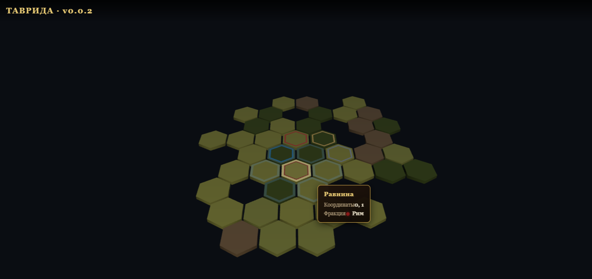
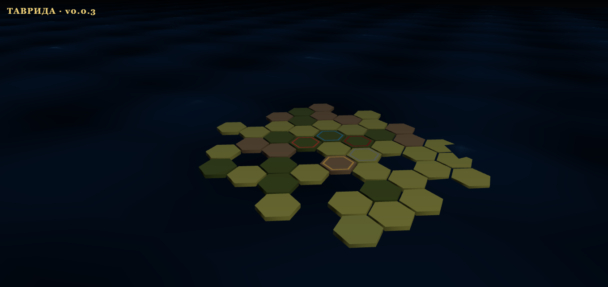
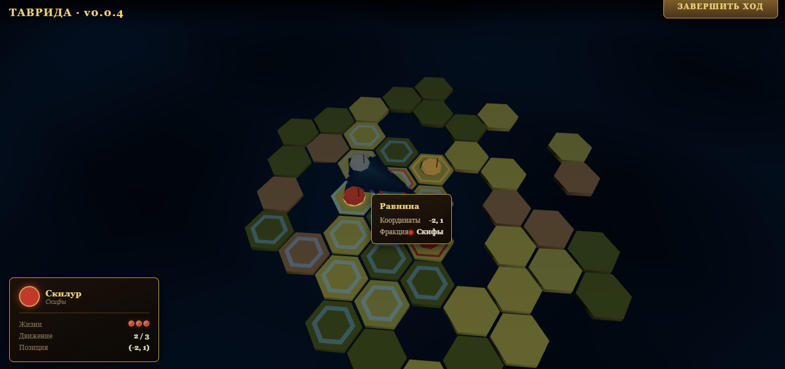
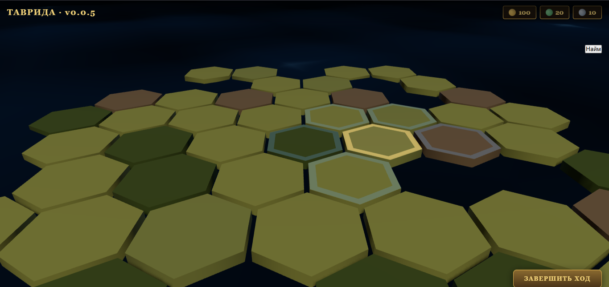
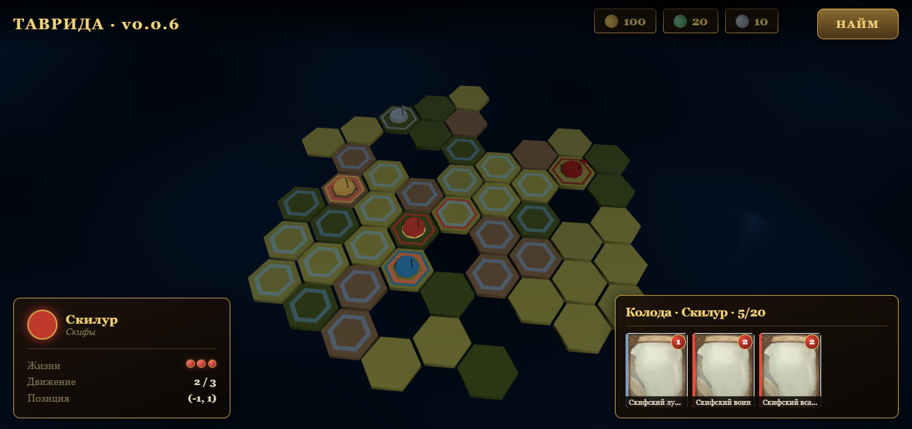
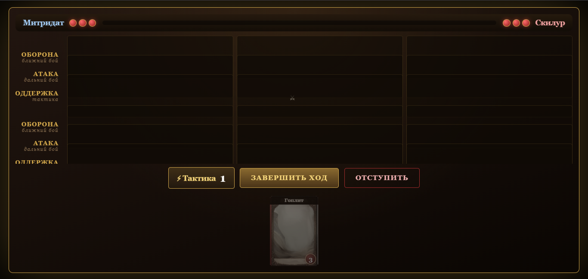
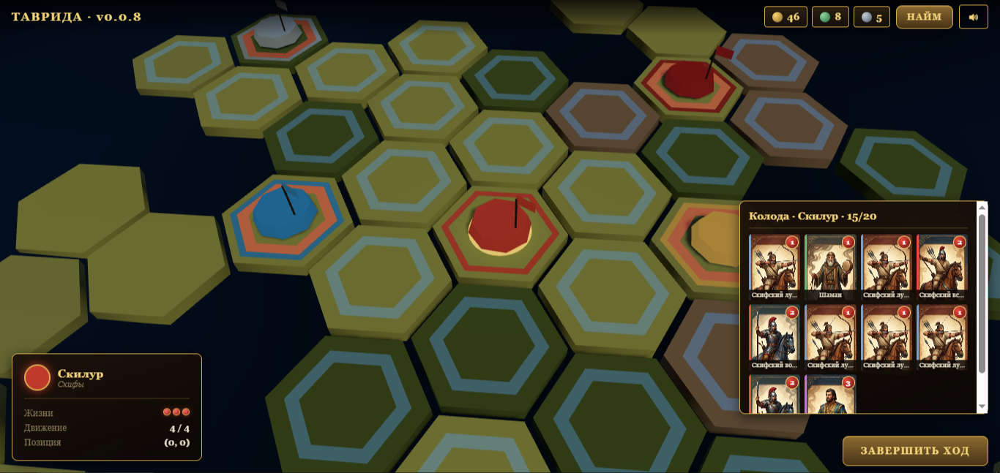
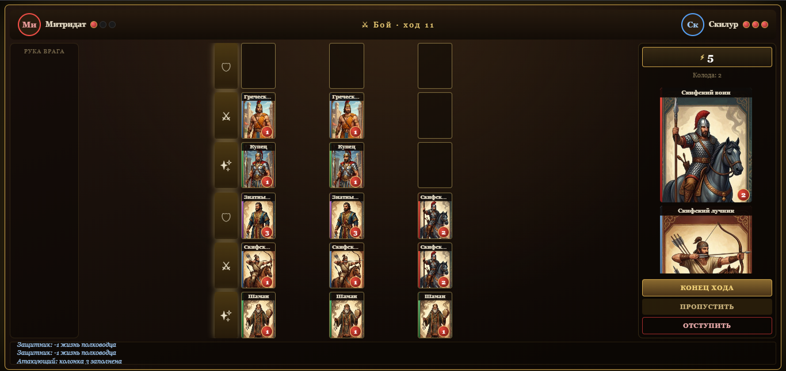
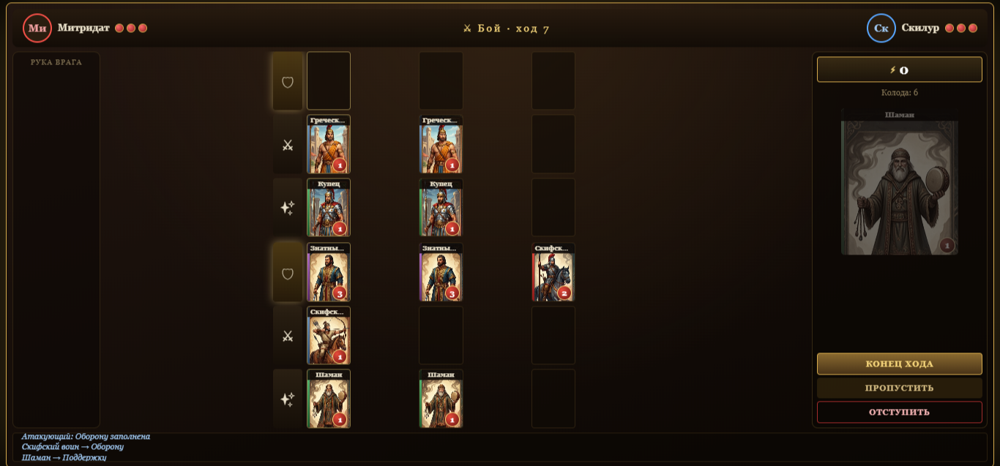
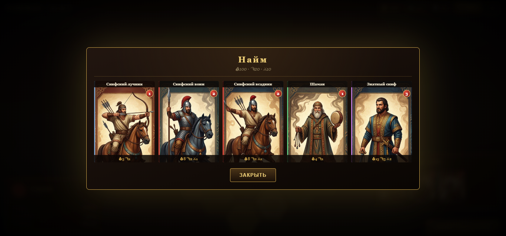
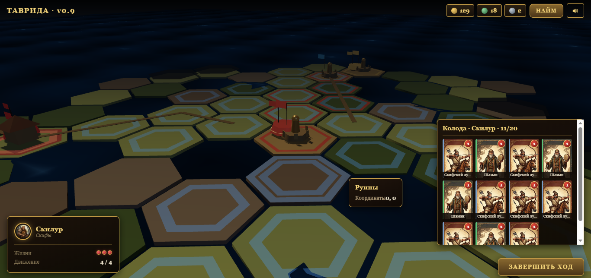
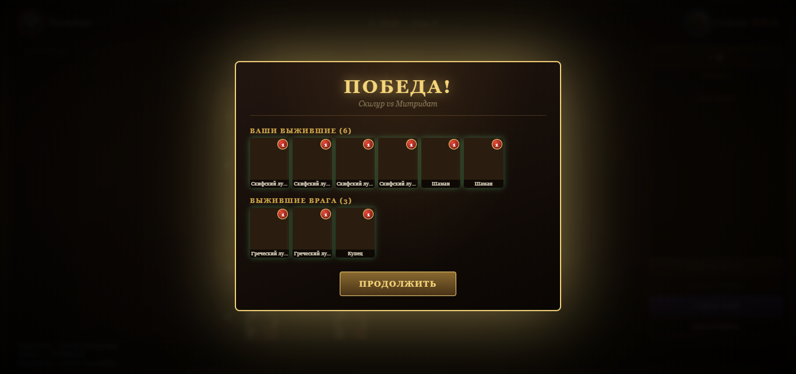
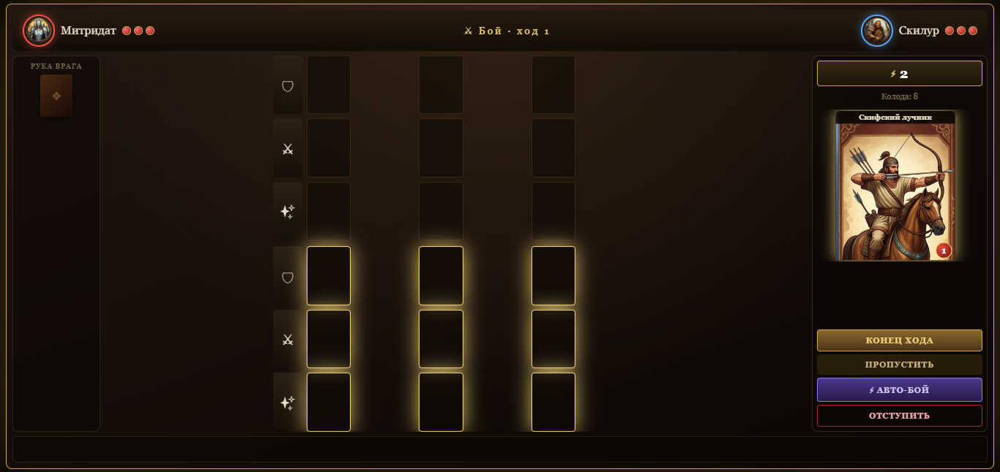
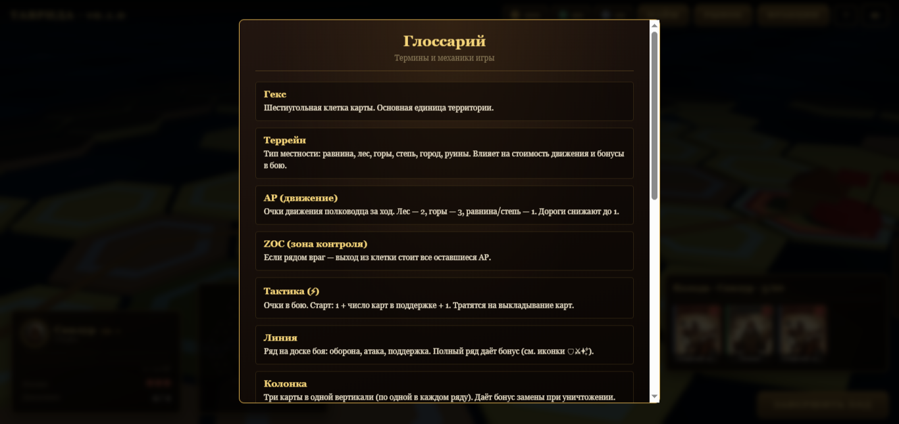
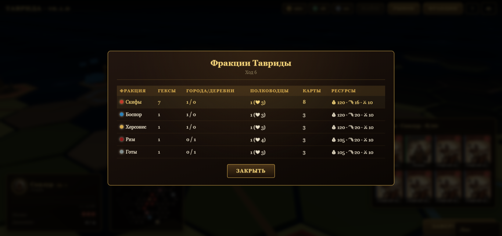
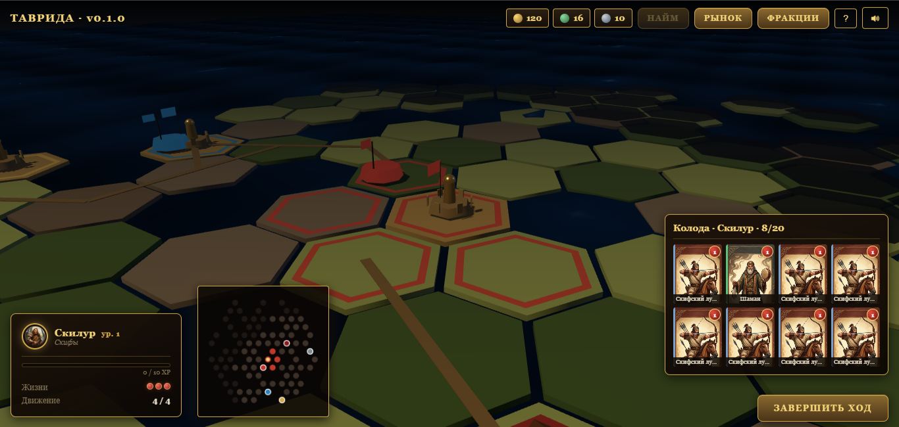

---

## Особенности

<table>
<tr>
<td width="50%" valign="top">

### 🏛️ Историческая достоверность
Сеттинг — Крым IV в. до н.э. — I в. н.э. Пять реальных фракций: скифы, Боспор, Херсонес, Рим, готы. Города на карте — Неаполь Скифский, Пантикапей, Херсонес, Феодосия, Керкинитида, Сурож.

</td>
<td width="50%" valign="top">

### 🗺️ Два слоя в одной игре
Стратегическая гекс-карта с движением, туманом войны, ZOC и экономикой. И тактический карточный бой 3×3 с линиями обороны, атаки и поддержки — всё в одном матче.

</td>
</tr>
<tr>
<td width="50%" valign="top">

### ⚔️ Тактика без клик-спама
Карты на поле не совершают действий — они триггерят способности на события. Залп, щит, месть, шипы, яд, горение, вдохновение — всё срабатывает от выхода карты, урона, смерти союзника.

</td>
<td width="50%" valign="top">

### 🎯 Бонусы за композицию
Полный ряд даёт командный бонус (урон полководцу, блок обилок, реген). Полная колонка — обязательная замена при уничтожении карты, даже в кредит тактики. Награда за планирование, а не за силу отдельной карты.

</td>
</tr>
<tr>
<td width="50%" valign="top">

### 🏔️ Террейн решает
Лес удешевляет лучников, горы удорожают воинов, степь — не для стрелков. В городе нападающий платит +1 за каждую карту. Один и тот же отряд стоит по-разному в зависимости от места боя.

</td>
<td width="50%" valign="top">

### 💰 Живая экономика
Ресурсы: золото, провизия, оружие. Доход от гексов и городов. Найм ограничен очками (2 за город + 1 за деревню). Общий рынок с аукционом между фракциями — можно продать карту врагу или перекупить чужую.

</td>
</tr>
<tr>
<td width="50%" valign="top">

### 🌱 Полководцы растут
Уровни, XP, уникальные перки фракций. За победу +10 XP. На чётных уровнях — бонус: движение, жизни или вместимость колоды. Один и тот же полководец с течением партии играет по-разному.

</td>
<td width="50%" valign="top">

### 🎨 Атмосфера
3D-сцена на Three.js: шейдерное море с волнами и бликами, звёздное небо, дороги между городами, туман войны. Бой — с фонами по террейну, снарядами, всплывающими цифрами урона и экраном результата с выжившими.

</td>
</tr>
<tr>
<td width="50%" valign="top">

### ✨ Чистая архитектура
Domain не знает о Three.js и DOM. Renderer читает домен, но не меняет. Всё через EventBus. Каждая механика — отдельный сервис: Battle, MovementService, EconomyService, RecruitService, Market, VisibilityService.

</td>
<td width="50%" valign="top">

### 📱 Браузер без установки
Vanilla JS + Vite, никаких фреймворков. Работает на десктопе и адаптируется под мобильные. Hot-reload при разработке, статическая сборка для публикации.

</td>
</tr>
</table>

---

> **«Это — исконная Скифия, она начинается от устья Истра, обращена к югу и простирается до города, называемого Каркинитидой. Отсюда идёт гористая страна, лежащая вдоль того же моря. Она выдаётся в Понт и населена племенем тавров вплоть до так называемого Херсонеса Скалистого. Херсонес этот на востоке выступает в море. <…> Тавры живут в части Скифии, соответствующей Аттической земле, как если бы не афиняне, а другое племя в Аттике занимало мыс Суний, выступающий дальше в море, т. е. пространство от Форика до селения Анафлиста. Я сравниваю это, насколько можно сравнить малое с великим. Так же обстоит и с Таврией. Тому же, кто не плавал мимо этого мыса Аттики, я разъясню на другом примере. Тавры обитают в этой части Скифии так, как если бы в Иапигии другое племя, а не иапиги отрезало бы для себя землю от гавани Брентесия до Таранта и населяло бы полуостров. Кроме этих двух стран, я мог бы назвать ещё много других, на которые похожа Таврия»**
> 
> ~ Геродот 🏺 «Мельпомена» Гл. 99 

